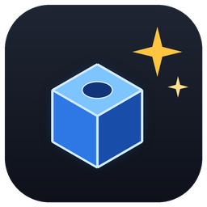
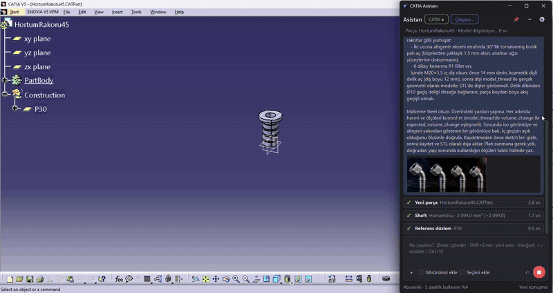
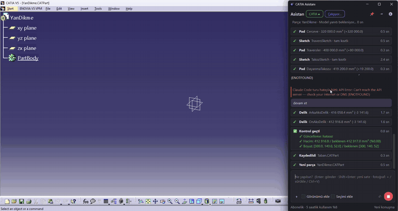
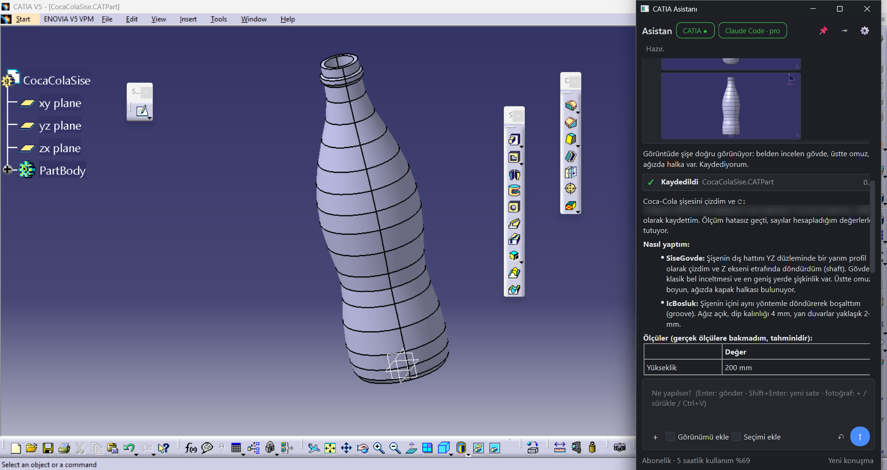

<p align="center"></p>

# CATIA V5 AI Assistant

   

> ⚠️ **Alpha software.** This project is in an early alpha stage (not yet beta). Expect bugs, breaking changes
> and missing features — it is under active development. Save your CATIA work before using it.

An AI agent built for CATIA: a natural-language assistant that drives **CATIA V5 R20** through its official COM Automation API.
Describe a part or an assembly in plain words (optionally with a photo/sketch); the assistant plans it,
builds it in CATIA step by step with real features (pads, pockets, holes, patterns, constraints…), and checks the result.

> **Türkçe özet aşağıda** — [Türkçe](#türkçe)

> This project is **not affiliated with, endorsed by, or sponsored by Dassault Systèmes or Anthropic.**
> CATIA is a trademark of Dassault Systèmes. Claude is a trademark of Anthropic.

## Demo

**New in v0.2.0-alpha** — a 45° elbow hose fitting with a real modelled M20×1.5 thread, softened hexagon and steel material:



*A ~70-second session sped up to 30 seconds.*



*A ~5-minute session building a catapult — parts, then the assembly with constraints — sped up to 30 seconds.*

See [CHANGELOG.md](CHANGELOG.md) for what changed in each version.

## Screenshots



*The assistant (right) built this bottle with a revolved profile (shaft) and a groove for the hollow inside, then checked and saved it.*

## What it does

- **Part Design:** sketches (lines, arcs, circles, rectangles, constraints), pad, pocket, shaft, groove, hole,
  fillet, chamfer, rectangular/circular patterns, mirror; measurements and topology checks.
- **Assembly:** insert components, position them, constraints (fix / coincidence / contact / offset / angle),
  CATIA clash analysis, overall bounding box and "fits within" check.
- **Helical features:** one-call compression springs (closed/ground ends), helix + sweep (rib/slot) for custom
  helical shapes, straight/diagonal/cross **knurling** (e.g. heat-set inserts), **threaded holes** (ISO metric,
  cosmetic threads, or real modelled ISO thread geometry for holes and shafts), and **materials** from the CATIA catalogue (brass, steel, aluminium…).
- Export to STEP / STL, view captures so the model can see what it built.
- Undo journal: every change made by the assistant can be rolled back.
- **English / Türkçe** interface — switch under ⚙ settings → *Language* (restart to apply); the agent then answers in that language.
- 51 tools in total, exposed as a local MCP server.

## Requirements

- Windows 10/11 **64-bit**
- **CATIA V5 R20 64-bit** (win_b64), installed and licensed — only R20 has been tested
- One of:
  - **Claude Code** signed in with a claude.ai **Pro/Max** subscription (recommended, no API key needed), or
  - an API key for **Claude API**, **OpenAI** or **Google Gemini**
- For running from source: Python 3.12 64-bit

## Installation

### Option A — ready-made `.exe` (no Python needed)

1. Download `CATIA-Asistan-win64.zip` from the [Releases](../../releases) page.
2. Extract it anywhere and run `CATIA-Asistan.exe`.

**Windows SmartScreen:** the exe is not code-signed, so Windows may show
"Windows protected your PC". Click **More info → Run anyway**. If you prefer, run from source instead (Option B).

### Option B — from source

```bat
git clone <this repository>
cd Catia-AiBot
python -m venv .venv
.venv\Scripts\python.exe -m pip install -r requirements.txt
```

## Usage

1. Start CATIA V5.
2. Double-click **`CATIA-Asistan.bat`** (or `CATIA-Asistan.exe`). It opens without a console window;
   errors are logged to `%LOCALAPPDATA%\CatiaAiBot\app.log`.
3. Pick a working folder, choose the backend (Claude Code or an API provider) and type your request.
   Attach images with **+**, drag-and-drop or Ctrl+V.

API keys are entered in the app's own key dialog (or `scripts\set_api_key_gui.py`) and stored in the
**Windows Credential Manager** — never in files.

Command line:

```bat
.venv\Scripts\python.exe scripts\agent_cli.py -m "50x30x10 mm block with an 8 mm through hole in the middle"
.venv\Scripts\python.exe scripts\agent_cli.py --provider gemini -m "..."
```

## Architecture

```
PySide6 UI ──► Claude Code (your subscription)  ──┐
          └──► API providers (Claude/OpenAI/Gemini)┤
                                                   ▼
                     MCP server (127.0.0.1, token-protected)  catia_aibot/mcpserver.py
                                                   ▼
                     Tool layer (Part Design + Assembly)       catia_aibot/tools/
                                                   ▼
                     COM thread / session / undo journal       catia_aibot/catia/
                                                   ▼
                                               CATIA V5
```

- `catia_aibot/agent/claude_code.py` — Claude Code bridge; `catia_aibot/agent/providers/` — API providers;
  `catia_aibot/agent/skill_catia.md` — modelling guide given to the model.
- [`docs/R20_API_NOTLARI.md`](docs/R20_API_NOTLARI.md) — R20 API behaviours and pitfalls verified on this setup (Turkish).

## Security

- The assistant **only writes inside the chosen working folder**; paths outside it are rejected.
- Claude Code is started with **all built-in tools disabled** (`--tools ""`) — no shell, no file access —
  and connected only to this app's MCP server.
- The MCP server listens on **127.0.0.1 only** and requires a random per-session token.
- API keys live in the Windows Credential Manager.

## Known limitations

- Tested only on **CATIA V5 R20 (64-bit)**; other releases may differ.
- Only **Part Design** and **Assembly** workbenches (no surfaces, drafting, sheet metal…).
- Complex freeform shapes (e.g. car bodies) are out of scope.
- The OpenAI / Gemini / Claude API providers are implemented but less tested than the Claude Code path.
- Some low-level error messages coming from the CATIA tool layer are still in Turkish.
- **Alpha:** behaviour and file layout may change between versions.

## Tests

```bat
.venv\Scripts\python.exe -m pytest -q
```

Tests that need CATIA are skipped when CATIA is not running.

## License

MIT © 2026 Ifcera — see [LICENSE](LICENSE).

Third-party: the UI uses **PySide6 (Qt for Python)**, licensed under **LGPL-3.0**. It is used unmodified as a
dynamically linked library; in the `.exe` release the Qt/PySide6 DLLs are shipped as separate files and can be
replaced. Source: <https://code.qt.io/cgit/pyside/pyside-setup.git/>.

---

## Türkçe

> ⚠️ **Alfa sürüm:** proje henüz beta öncesi, erken geliştirme aşamasında; hatalar ve büyük değişiklikler olabilir.

CATIA için geliştirilmiş bir AI agent: CATIA V5 R20'yi resmî COM API'si üzerinden yöneten, doğal dille çalışan asistan. Parçayı ya da montajı
kelimelerle (isterseniz fotoğrafla) anlatırsınız; asistan planlar, CATIA'da gerçek özelliklerle adım adım çizer
ve sonucu kontrol eder.

> Bu proje **Dassault Systèmes ya da Anthropic ile bağlantılı değildir**.

**v0.2.0-alpha'da yeni:** tek çağrıda basma yayı, helix + sweep, tırtıl; ISO metrik kozmetik ve gerçek (modelli) diş
(`model_thread`, iç/dış, eğik eksenlerde de); CATIA kataloğundan malzeme ve kütle; token kullanımında belirgin azalma;
kör delik derinliği, kenar uzunluğu birimi ve eğri gövdelerde sınır kutusu düzeltmeleri. Toplam 51 araç, 100 test.
Ayrıntılar: [CHANGELOG.md](CHANGELOG.md).

**Gereksinimler:** Windows 64-bit, CATIA V5 R20 64-bit, ve Claude Code (claude.ai Pro/Max aboneliği) **ya da**
Claude / OpenAI / Gemini API anahtarı.

**Kurulum:**
- Hazır sürüm: [Releases](../../releases) sayfasından `CATIA-Asistan-win64.zip` indirin, açın,
  `CATIA-Asistan.exe` çalıştırın. Exe imzalı olmadığı için Windows SmartScreen uyarı verebilir:
  **Ek bilgi → Yine de çalıştır**.
- Kaynaktan: `python -m venv .venv` ardından `.venv\Scripts\python.exe -m pip install -r requirements.txt`.

**Kullanım:** CATIA'yı açın, `CATIA-Asistan.bat` (ya da `.exe`) dosyasına çift tıklayın, çalışma klasörünü seçin
ve isteğinizi yazın. Arayüz dili ⚙ ayarlarından **Türkçe / English** olarak değiştirilebilir (yeniden başlatınca geçerli olur). Fotoğraf: **+**, sürükle-bırak ya da Ctrl+V. Hatalar: `%LOCALAPPDATA%\CatiaAiBot\app.log`.

**Güvenlik:** yalnızca seçilen çalışma klasörüne yazar; Claude Code yerleşik araçları kapalı başlatılır; araçlar
yalnızca 127.0.0.1'de, belirteçle korunan bir MCP sunucusunda açılır; API anahtarları Windows Kimlik Bilgileri
Yöneticisi'nde tutulur.

**Sınırlar:** yalnızca R20'de denendi; yalnızca Part Design ve Assembly.

API notları: [`docs/R20_API_NOTLARI.md`](docs/R20_API_NOTLARI.md). Lisans: MIT © 2026 Ifcera. Arayüz PySide6 (LGPL-3.0) kullanır.
